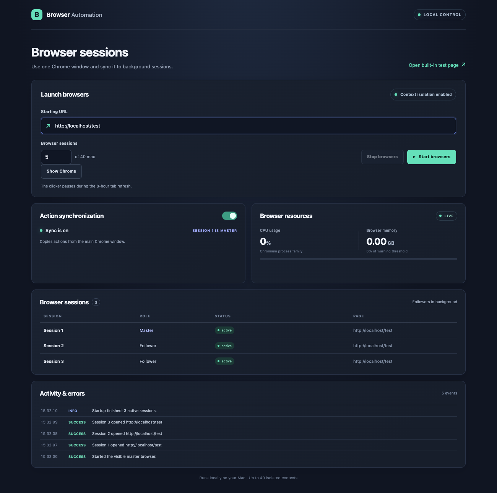
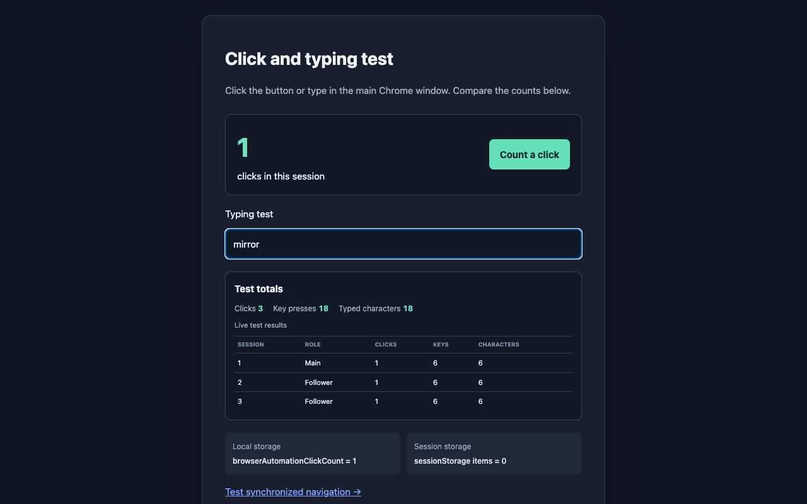

# Cursor Click

I wanted one app for my auto clicker and Chrome sessions. I use the main Chrome window and let the background sessions follow along. The built-in test page is a quick way to see sync working.





## Build and run

On a Mac with Node.js and the Xcode Command Line Tools, run this from the repository folder:

```sh
./build-macos.sh
open "dist/Cursor Click.app"
```

For auto clicking, allow **Terminal** under **System Settings → Privacy & Security → Accessibility**. Click **Start clicking** and move the pointer over your target during the five-second countdown. To stop, press **Control-C** or click **Stop clicking**.

Cursor Click is macOS-only. [MIT License](LICENSE).
